 

 

### 👩🏽‍💻 Sobre mim | About me

`PT-BR` Olá! Me chamo **Stephany Fernandes Torres**, sou **Estudante de Ciência da Computação** na Universidade Federal de Ouro Preto (**UFOP**) e **Desenvolvedora de Software Full-Stack**. Atualmente, atuo como **Pesquisadora de Machine Learning** no **Instituto Tecnológico Vale (ITV)** e colaboro voluntariamente no desenvolvimento web do projeto **OpCoders Judge**.

 

`US` Hi! My name is **Stephany Fernandes Torres**, I am a **Computer Science student** at the Federal University of Ouro Preto (**UFOP**) and a **Full-Stack Software Developer**. Currently, I work as a **Machine Learning Researcher** at the **Instituto Tecnológico Vale (ITV)** and volunteer in web development for the **OpCoders Judge** project.

 

### 💻 Tecnologias & Ferramentas | Technologies & Tools

#### Linguagens & Bancos de Dados

 
  
  
  
  
  
  
  
  
  

  

#### Frameworks & Ferramentas

 
  
  
  
  
  
  
  

 

### 📊 Estatísticas | Statistics

  

 
